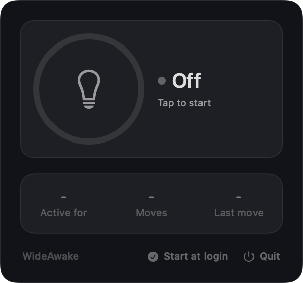
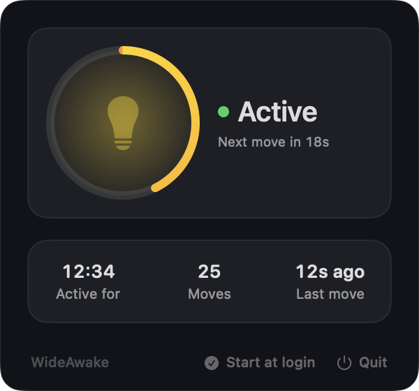

# Wide Awake

Similar to the Move Mouse app, for MacBook.

A tiny macOS menubar app that keeps your Mac and apps like Slack looking active.
Click the lightbulb in the menubar, then tap the bulb to turn it on.

<p align="center">
  
  
</p>

- Every 30 seconds it nudges the cursor 5px and back, taps Shift, and holds off display and system sleep.
- It skips a nudge if you were using the Mac in the last 10 seconds.
- Optional "Start at login".

## Build

```bash
./build.sh
```

The icon is generated by `icon.swift` (already built into `AppIcon.icns`).
Produces a universal (Apple Silicon + Intel) `Wide Awake.app`, macOS 14 or newer.

## First run

Grant Accessibility access (System Settings > Privacy & Security > Accessibility) so macOS lets the app post input events.
If macOS blocks the app, run `xattr -cr "/Applications/Wide Awake.app"` or right-click it and choose Open.

## Install

Download `WideAwake.dmg` from the latest release, open it and drag Wide Awake into Applications.
